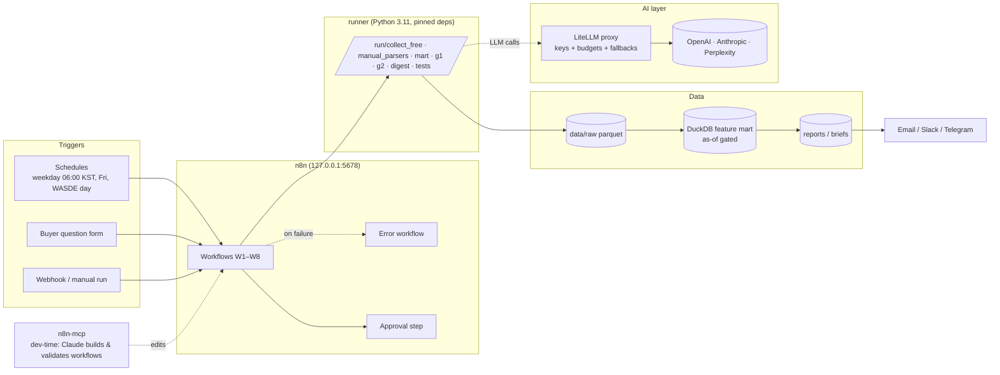

# Nexus Automation Workflow Architecture (draft, 2026-11-17)

> Status: proposal for the owner's review — not yet a decision. Builds on D-053 (laptop Docker + n8n replaces
> GitHub Actions) and the G2 Preview plan (R-043, due 11/19). Nothing here changes models or data contracts.

## 1. Design principles

1. **One scheduler, one executor.** n8n decides *when* and *in what order*; the Python `runner` container decides
   *how*. n8n never contains analysis logic; Python never contains schedules. (Keeps every job testable with pytest.)
2. **Whitelisted jobs only.** n8n calls `POST runner:8000/run/<job>`; the runner refuses anything not in `JOBS`
   (already the case in `docker/jobs.py`). New capability = new job name + test, not a new n8n code node.
3. **Fail closed, report loud.** Gates (`mart`, as-of, DQ) stop the chain; every failure goes to one n8n *Error
   Workflow* that posts a 4-field report (title / content / likely cause / support needed — R-016 format).
4. **Human gate is a workflow step.** Anything that touches a Buy/Hold decision ends in an n8n approval
   (Form/Wait node), never in an automatic action (CLAUDE.md §6).
5. **Same compose file everywhere.** Laptop = development; an always-on server (Oracle Always Free ARM first,
   cheap VPS as fallback) = production. Only `.env` differs.
6. **One LLM gateway.** All model calls (OpenAI cross-verify, Perplexity digest, Anthropic) go through one proxy
   with per-key budgets, so cost caps (e.g. DQ-44 $10) are enforced in one place.

## 2. Layers

## 3. Reference tools — verdict

| Tool | What it is | Verdict for Nexus | Why |
|---|---|---|---|
| **n8n-mcp** | MCP server exposing n8n node docs + workflow CRUD to AI agents | **Adopt now** (already pulled, `2.102.0` pinned by digest) | Lets Claude design/validate n8n workflows instead of hand-editing JSON — fastest way to port the 21 Actions workflows |
| **LiteLLM** | OpenAI-compatible proxy over 100+ providers | **Adopt with G2 Preview+** | Single key store, per-key spend limits, fallbacks, request logs; Python scripts only change `base_url` |
| **CrewAI** | Role-based agent crews (Python) | **Optional, later** | Fits the runner (Python) if the "expert-lens panel" reviews should run unattended; today Claude Code subagents already do this on demand |
| **Letta** | Stateful agents with self-editing memory | **Skip for now** | MEMORY.md + monthly archive + planned Knowledge Mart (R-020) already cover project memory; adds a server + DB |
| **Dify** | Full LLM app platform (workflows, RAG, agents) | **Skip** | Overlaps n8n as orchestrator; ~10 containers / several GB RAM; would split logic across two workflow engines |
| **Langflow** | Drag-and-drop agent/RAG canvas | **Skip** (prototype-only at most) | Same overlap; useful only to sketch a RAG flow before coding it in Python |
| **Mastra** | TypeScript agents/workflows + studio | **Skip** | Project is Python-first and Node is intentionally not installed on the host |
| **OpenHands** | Autonomous coding agent in a sandbox | **Skip** | Overlaps Claude Code; heavy sandbox; not needed for scheduled data work |

Rule of thumb: **one orchestrator (n8n), one language for logic (Python), one LLM gateway (LiteLLM).**
Each extra platform costs RAM on a 12 GB free server and a second place where logic can hide.

## 4. n8n workflow catalogue (port from GitHub Actions)

| # | n8n workflow | Trigger | Runner jobs (in order) | Replaces Actions file(s) |
|---|---|---|---|---|
| W1 | Daily data refresh | Mon–Fri 06:00 KST | `collect_free` → `manual_parsers` | `external_data_refresh.yml`, `run_data_integration_now.yml` |
| W2 | Quality + mart gate | after W1 | `mart` (readiness → mart → as-of) — stop on fail | `quality_gate.yml` |
| W3 | G1 daily brief / alerts | after W2 | `g1` (alert mode) → notify only if alert or as signed "no news" | G1 jobs in `external_data_refresh.yml` |
| W4 | Weekly brief | Fri 07:00 KST | `g1` (weekly) + `g2` band | weekly part of D-043 |
| W5 | Monthly deep run | WASDE release +1 business day | `g1` (monthly) + `baseline` | monthly part of D-043 |
| W6 | Unstructured digest | daily 05:30 KST | `digest` (Perplexity via LiteLLM) | `unstructured_analysis.yml` |
| W7 | Buyer question (G3) | n8n Form | `g3_sim` → **approval step** → send | new |
| W8 | Error handler | any failure | none — formats R-016 report, notifies | Ralph-loop issue job |
| — | Backfill / one-offs | manual | `databento` (disabled until cap approved), historical parsers | `historical_backfill.yml`, `run_historical_now.yml` |

The current `docker/n8n/g2_preview.json` already implements W1+W2+baseline as one chain; split it into W1–W3
when the G1/G2 jobs are added to `JOBS`.

## 5. Hosting path

1. **Now (laptop):** current compose. Runs only while the laptop is on.
2. **Production (always-on):** Oracle Cloud Always Free ARM (Seoul/Chuncheon), Ubuntu + Docker, same compose.
   Fallback: a ~US$5–6/month VPS. Images are multi-arch (python:3.11-slim, n8nio/n8n) — rebuild runner on ARM.
3. **Access:** keep n8n bound to 127.0.0.1; reach it via Tailscale (private) or Cloudflare Tunnel (webhooks).
4. **State:** `n8n_data` volume (credentials + encryption key) and `data/` backed up nightly (e.g. rclone to
   the owner's Google Drive, per D-053). Workflows exported to `docker/n8n/*.json` and committed.

## 6. Next steps (proposed order)

1. Owner: create n8n owner account + API key; put the key into `docker/.mcp.json` (owner only).
2. Add `id` to `docker/n8n/g2_preview.json` (n8n 2.x import requires it — currently fails without).
3. Add runner jobs `g1`, `g2`, `digest` wrapping existing scripts; split the n8n chain into W1–W3 + W8.
4. Put LiteLLM in compose with a budget per key; point OpenAI/Perplexity clients at it.
5. Move to the Oracle ARM instance once W1–W3 run green for a week on the laptop.
